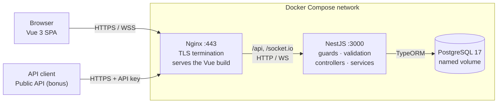
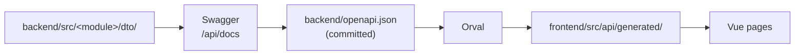

# Architecture

Task Marketplace (ft_transcendence). A Vue 3 single-page app and a NestJS REST API behind Nginx over HTTPS, with PostgreSQL as the single source of truth. Everything starts with one command: `make`.

## Contents

- [Overview](#overview)
- [Tech stack](#tech-stack)
- [Request flow](#request-flow)
- [Repository layout](#repository-layout)
- [Frontend](#frontend)
- [Backend](#backend)
- [API contract](#api-contract)
- [Authentication](#authentication)
- [Validation](#validation)
- [Data model](#data-model)
- [Concurrency](#concurrency)
- [Infrastructure and local development](#infrastructure-and-local-development)

## Overview



- Only Nginx is reachable from outside (port 443; port 80 redirects to 443).
- Traffic inside the Docker network is plain HTTP/TCP, which the subject allows.
- Only NestJS talks to the database. The frontend never does.

## Tech stack

Everything is TypeScript (strict) on Node.js 26 LTS.

| Layer | Technologies | Role |
| --- | --- | --- |
| Frontend | Vue 3 (Composition API), Vite, Vue Router, Pinia | SPA built to static files; routes with login guards; shared state |
| UI and forms | Tailwind CSS, shadcn-vue (Reka UI), VeeValidate + Zod | Styling, accessible components (WCAG 2.1 AA), form validation |
| API client | Orval + `api.ts` (fetch) | Generated types, endpoint functions and Zod rules; cookies and refresh-and-retry |
| Backend | NestJS, @nestjs/config, class-validator + ValidationPipe | REST API under `/api`, one module per feature, validated input |
| Auth | argon2, Passport + @nestjs/jwt | Hashed passwords; access and refresh tokens in httpOnly cookies |
| API docs | @nestjs/swagger (OpenAPI) | Contract generated from DTOs at `/api/docs`, exported to `openapi.json` |
| Database | PostgreSQL 17, TypeORM | Entities, migrations, transactions, row locks, constraints |
| Events | @nestjs/event-emitter | Domain events after commit; notifications, real-time and XP listen |
| Real-time (Phase 2) | Socket.IO | Server push to open browsers over WSS |
| Infrastructure | Docker Compose, Nginx, OpenSSL, Make | Three containers, HTTPS, single start command |
| Quality | GitHub Actions, ESLint, Prettier, Jest, Vitest, Playwright, commitlint | CI on every pull request; end-to-end and race tests |

## Request flow

Nginx receives two kinds of requests:

1. **Opening the site (once):** `GET https://localhost/`. The path doesn't start with `/api`, so Nginx returns `index.html`, the JS and the CSS of the Vue build. The Vue app now runs in the browser.
2. **Every action:** e.g. `POST /api/tasks/7/accept`. The path starts with `/api`, so Nginx forwards it to NestJS, which checks the rules, talks to PostgreSQL and returns JSON.

Nginx rule: `/api/*` → backend · `/socket.io/*` → backend with WebSocket upgrade (Phase 2) · anything else → a file of the Vue build, with `index.html` as fallback for app routes like `/tasks/7`.

## Repository layout

```
ft_transcendence/
├── frontend/                     # Vue 3 + Vite + TypeScript (tech lead + PO)
│   ├── src/pages/                # one file per page
│   ├── src/components/           # reusable UI; shadcn-vue components in components/ui/
│   ├── src/stores/               # Pinia
│   ├── src/router/               # Vue Router
│   ├── src/api/api.ts            # fetch wrapper: base URL, cookies, refresh-and-retry
│   ├── src/api/generated/        # written by Orval from openapi.json, never edited by hand
│   └── Dockerfile                # multi-stage: Vite build → Nginx image
├── backend/                      # NestJS + TypeORM
│   ├── src/auth/                 # backend dev 1
│   │   ├── auth.controller.ts    # endpoints
│   │   ├── auth.service.ts       # rules and logic
│   │   ├── auth.module.ts
│   │   └── dto/                  # register.dto.ts, login.dto.ts (input), user.dto.ts (output)
│   ├── src/users/                # backend dev 1 (same layout + entities/)
│   ├── src/tasks/                # backend dev 2 (same layout + entities/)
│   ├── src/wallet/               # backend dev 2 (same layout + entities/)
│   ├── src/common/               # config, error filter, shared pipes
│   ├── src/migrations/           # TypeORM migrations, in order (backend dev 1)
│   ├── openapi.json              # exported Swagger description, committed with every API change
│   └── Dockerfile
├── infrastructure/
│   └── nginx/                    # nginx.conf + gen-cert.sh (OpenSSL) (backend dev 2)
├── tests/                        # Playwright end-to-end and race tests (PM)
├── docs/                         # decisions, API conventions, database diagram
├── .github/workflows/            # CI (PM)
├── docker-compose.yml            # db, backend, nginx
├── .env.example                  # every variable, no real secrets (.env is git-ignored)
├── Makefile                      # make = start everything
├── ARCHITECTURE.md
└── README.md
```

Later modules add folders under `backend/src/` (`notifications/`, `realtime/`, `friends/`, `chat/`, `files/`), each with one owner.

## Frontend

- **Vite:** `npm run dev` serves the app with instant reload and proxies `/api` to `localhost:3000`. `npm run build` writes plain HTML/JS/CSS to `dist/`, copied into the Nginx image.
- **Vue Router:** URL → page (`/tasks/:id` → `TaskDetailPage`); guards redirect logged-out users to `/login`.
- **Pinia:** one shared copy of the current user, wallet balance and (Phase 2) live events.
- **API calls:** pages use Orval-generated functions and types from `src/api/generated/`. Every call goes through `src/api/api.ts`, which handles the base URL, cookies, error mapping, and on 401 calls `/api/auth/refresh` once and retries.
- **Components:** shadcn-vue (copied into `src/components/ui/`, ours to change) gives keyboard, focus and screen-reader behaviour for dialogs, menus, tabs and inputs.
- **Startup:** the app calls `GET /api/auth/me`; success fills the user store, 401 means logged out.

## Backend

Every request passes four stations:

1. **Guard:** logged in and allowed? Otherwise 401 / 403.
2. **ValidationPipe:** body matches its input DTO? Otherwise 400. `whitelist: true` strips unknown fields.
3. **Controller:** address → function. Web concerns only.
4. **Service:** business rules and database work, in a transaction where needed.

| Module | Tables | Responsibility | Phase |
| --- | --- | --- | --- |
| `auth` | — | Register, login, logout, refresh, me; JWT strategy, guard | 0 |
| `users` | users | Profiles, avatar | 1 |
| `tasks` | tasks, task_assignments, proof_submissions | CRUD, state machine, accept / submit / approve / dispute, search | 1 |
| `wallet` | wallets, ledger_entries | Reserve, release, refund, balance, history | 1 |
| `common` | — | Config, error filter, shared pipes | 0 |

Modules communicate through services or events, never through another module's tables. After a successful commit, services emit domain events (`task.accepted`, …) with `@nestjs/event-emitter`; notifications, real-time and gamification are listeners.

## API contract

| Topic | Rule |
| --- | --- |
| Paths | `/api` prefix, plural nouns, actions as sub-paths: `POST /api/tasks/:id/accept` |
| JSON | camelCase |
| Status codes | 200/201 · 400 invalid input · 401 not logged in · 403 not allowed · 404 not found · 409 conflict |
| Errors | `{ statusCode, message, errors: [{ field, message }] }` |
| Lists | `?page=1&limit=20` → `{ items, total, page, limit }` |
| Dates, money | ISO 8601 in UTC; credits as integers |

Every endpoint has an input DTO (class-validator rules) and an output DTO declared with `@ApiOkResponse` / `@ApiCreatedResponse`, plus its main error responses, in `backend/src/<module>/dto/`.



- API changes ship with an updated `openapi.json` in the same pull request.
- CI regenerates the client and fails if it differs from what's committed.
- Changes to an agreed endpoint, the error format or the data model go through the tech lead.

## Authentication

- Passwords are hashed with **argon2** (salted automatically). Wrong email or password always returns the same 401.
- **Access token:** JWT, 15 minutes (`JWT_EXPIRES_IN`), sent with every request, checked by signature only.
- **Refresh token:** 7 days, stored in the database (revocable), sent only to `POST /api/auth/refresh`.
- Both are cookies with `HttpOnly`, `Secure` and `SameSite=Strict`. The frontend never reads them.
- Logout deletes the refresh token and both cookies. A password change deletes all of a user's refresh tokens.

## Validation

| Kind of rule | Checked by | Examples |
| --- | --- | --- |
| Shape of the input | Both (Zod + VeeValidate, class-validator) | Email format, password ≥ 8, display name 2–30, bounty integer ≥ 1, file type and size |
| Only meaningful in the form | Frontend only | Repeat password matches, confirmation dialogs |
| Needs the database, state or trust | Backend only | Email taken, correct password, bounty ≤ available credits, task still OPEN, not your own task, only the creator approves |

Shape rules are written once in the backend DTOs and reach the frontend as generated Zod.

## Data model

| Table | Key columns | Constraints |
| --- | --- | --- |
| users | id, email, password_hash, display_name, avatar_file_id | `UNIQUE(email)` |
| wallets | user_id, available, held | `CHECK(available >= 0)`, `CHECK(held >= 0)` |
| ledger_entries | id, wallet_id, task_id, type, amount, idempotency_key | `UNIQUE(idempotency_key)`, insert-only |
| tasks | id, creator_id, title, description, category, bounty, is_remote, status, escrow_status | `CHECK(bounty > 0)` |
| task_assignments | id, task_id, worker_id | `UNIQUE(task_id)` |
| proof_submissions | id, assignment_id, note, link_url | — |

Task states: `OPEN` → `ASSIGNED` → `SUBMITTED` → `COMPLETED` or `DISPUTED`; `CANCELLED` from `OPEN` only.

Credits (escrow): publish moves the bounty from the creator's `available` to `held` (RESERVE); approve moves it from the creator's `held` to the worker's `available` (RELEASE + RECEIVE); cancel moves it back (REFUND). Each step is one transaction with ledger rows.

Migrations live in `backend/src/migrations/` and run at startup (`migrationsRun: true`, `synchronize: false`). Pull `main` before generating one, one migration per pull request, never edit a merged migration.

## Concurrency

PostgreSQL decides every race; never "read, check in TypeScript, then write".

| Fix | Used for | How |
| --- | --- | --- |
| 1. Conditional update | One-row actions: accept, submit, dispute, cancel | `UPDATE tasks SET status = 'ASSIGNED' WHERE id = $1 AND status = 'OPEN'`; 0 rows → 409 |
| 2. Row lock in a transaction | Multi-row actions: approve, refund | `SELECT … FOR UPDATE` via TypeORM `setLock('pessimistic_write')` inside `dataSource.transaction()`; lock wallets in user-id order |
| 3. Constraints | Always | `UNIQUE(task_id)`, `CHECK(available >= 0)`, `UNIQUE(idempotency_key)` |

Proof: Playwright race tests in CI. 10 parallel accepts → one 200 and nine 409; 5 parallel approves → one payout.

## Infrastructure and local development

| Container | Contents | Notes |
| --- | --- | --- |
| `nginx` | Nginx + the built Vue app | HTTPS with a self-signed certificate created by OpenSSL at startup (`gen-cert.sh`); no keys in Git |
| `backend` | NestJS, `node dist/main`, port 3000 | Waits for a healthy database; applies migrations |
| `db` | PostgreSQL 17, named volume | Not reachable from outside |

Settings come from `.env` (git-ignored); `.env.example` lists every variable. `@nestjs/config` refuses to start if one is missing.

| Task | Command | Port |
| --- | --- | --- |
| Full stack (as the evaluator runs it) | `make` → `https://localhost` | 443 |
| Database only, for development | `docker compose up db` | 5432 (localhost only, via override file) |
| Backend with reload | `cd backend && npm run start:dev` | 3000 |
| Frontend with reload | `cd frontend && npm run dev` | 5173 |
| Regenerate the API client | `cd frontend && npm run api:generate` | — |
| Stop / clean | `make down` / `make fclean` | — |
